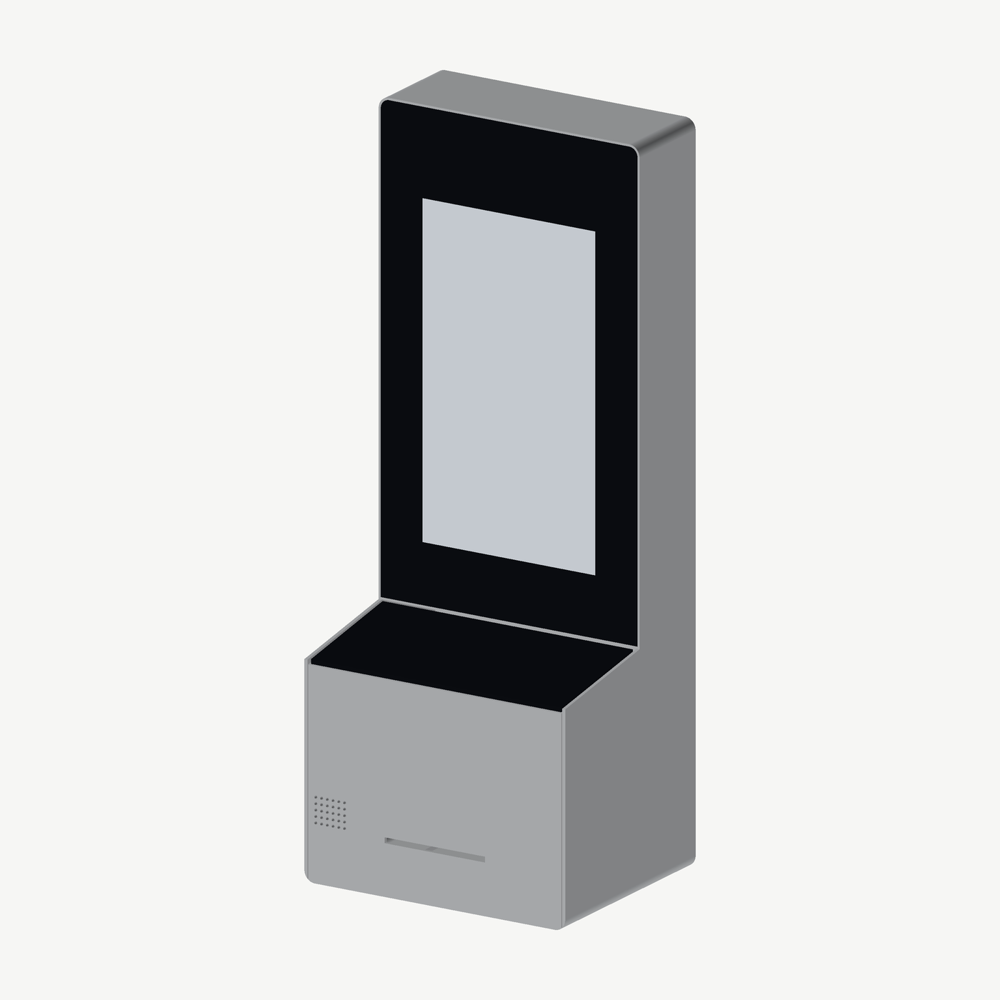

# Foyer VK-1 — visitor enrolment kiosk

A compact, premium self-service check-in kiosk for corporate office lobbies.
A visitor scans their invitation QR code (or registers as a walk-up), scans a
passport or ID card (OCR + NFC chip), has a face photo taken with liveness
detection, accepts the site rules, and gets a printed badge or mobile pass
while their host is notified through the visitor management system (VMS).



| | |
|---|---|
| Core unit | 250 W × 640 H × 200 D mm, ≈ 11 kg, anodised aluminium + 4 mm edge-to-edge glass |
| Compute | Raspberry Pi Compute Module 5 (4 GB / 32 GB eMMC, Wi-Fi 5 + BT 5.0), supply until ≥ Jan 2036 |
| Display | 13.3" 1920 × 1080 PCAP, portrait (Elo 1302L) |
| Identity | Full-page passport / ID reader, OCR + ePassport RFID (DESKO PENTA 4X Cube) |
| Face | RGB + NoIR 12 MP cameras with 850 nm IR flood for liveness |
| Invitation | Zebra DS55 2D scanner (reads QR from phone screens) |
| Badges | 80 mm thermal kiosk printer with cutter on a slide-out drawer |
| Audio | I2S class-D amplifier + speaker, 2 × I2S MEMS microphones (call reception) |
| Approach / status | ToF presence sensor, 24-LED status light bar |
| Connectivity | Gigabit Ethernet, Wi-Fi 2.4/5 GHz, Bluetooth; options: LTE fallback, HID NFC encoder |
| Power | Single PoE++ cable (802.3bt Type 4) or USB-C PD ≥ 65 W |
| Mounting | One core unit on desk, wall or floor kit (shared hang-on mount plate) |
| Security / privacy | Secure boot + full-disk encryption (CM5 OTP key), ATECC608B device identity, no PII at rest after sync |

## Repository map

```
foyer-kiosk/
├── hardware/
│   ├── interface-contract.md     HW⇄SW contract: buses, GPIOs, power policy (rev B)
│   ├── eda/                      circuit-as-code toolkit (ERC, schematic gen, PCB build, routing, DRC, fab)
│   ├── power/design_calcs.py     power-stage calculations (→ docs/power-design.md)
│   ├── carrier/                  FYR-CB-01 carrier board: carrier.py (circuit), build.py (layout+fab),
│   │                             kicad/ (KiCad 7 project), fab/ (gerbers, drill, BOM, CPL, STEP, PDFs)
│   ├── sensorbar/                FYR-SB-01 sensor bar: same structure
│   └── lib/                      vendored symbols + Foyer footprints (incl. CM5 socket)
├── mechanical/
│   ├── enclosure.py              parametric CadQuery model (enclosure + kits)
│   ├── build.py                  exports below
│   └── out/  step/ print/ dxf/ drawings/ renders/
├── software/                     enrolment app, device agent, OS image build (see software/README.md)
└── docs/                         spec, BOM, installation guide, maintenance manual, manufacturing,
                                  verification register, power design
```

## Requirement trace

| Requirement | How it is met | Where |
|---|---|---|
| Compact, modern, premium | 250 mm wide, edge-to-edge glass, anodised aluminium, no visible fasteners (lock hidden under the door lip, security screw under the mount) | `mechanical/`, renders |
| Locked-down kiosk OS, boots into the app | Raspberry Pi OS (arm64) image with cage + Chromium kiosk, hardened services | `software/os-image/` |
| QR or walk-up → ID + face → VMS → host notified → badge / mobile pass | Enrolment app + device agent with VMS adapter | `software/app`, `software/agent` |
| Publicly available, long-term compute | Raspberry Pi CM5, production to ≥ 2036 | `docs/bom-system.csv` |
| 10–13" portrait touch | 13.3" PCAP portrait | Elo 1302L |
| Camera with liveness | RGB + NoIR IMX708 pair + 850 nm IR flood on the sensor bar | `hardware/sensorbar` |
| QR reader, ID/passport reader (OCR + NFC), badge printer | DS55, DESKO PENTA 4X, Custom VKP80III; carrier USB 2 ×6 + USB 3 ×1 internal ports | carrier `J9–J12` |
| Speaker + mic | MAX98357A I2S amp + speaker header; 2 × ICS-43434 | carrier `U13`, sensor bar `MK1/2` |
| Proximity + status light | VL53L1X ToF wake; 24 × SK6812 light bar | sensor bar |
| GbE, 2.4/5 GHz Wi-Fi, BT | CM5 PHY + MagJack; CM5 wireless | carrier `J1` |
| LTE + NFC encoder (nice to have) | Internal USB ports + mounting positions | carrier `J11B`, `J12A` |
| Single PoE++ cable, USB-C PD alternative | Ag59812 PoE++ PD (12 V 89 W) + STUSB4500 PD sink → 12 V, ideal-diode OR | carrier power sheet |
| eMMC, encrypted | CM5 eMMC + secure-boot FDE (OTP key) | `docs/manufacturing.md` §4 |
| Wheelchair usable | Deck at 861 mm (ADA ≤ 864), reach mode keeps touch targets ≤ 1117 mm (≤ 1220), 2-hand-free document deck, audio prompts | GA drawing, app |
| No PII on device after sync | In-memory sessions, encrypted ≤ 24 h offline queue, wipe on sync | `software/agent` |
| Install < 30 min, one person, desk/wall/floor | Common hang-on mount plate, drilling template, zero-touch provisioning | `docs/installation-guide.md` |
| Front service, no tools, single lock | Lift-up head door captures the drop-down lectern door; one cam lock; thumbscrew/latch FRUs | `docs/maintenance-manual.md` |
| Paper < 1 min, modules < 5 min | Slide-out printer drawer; plug-in FRUs | maintenance manual §3–4 |
| Remote monitoring + OTA | Heartbeat + `/metrics`; signed OTA with rollback; unattended security updates | `software/` |
| Carrier board + mechanical outline | KiCad project, gerbers, outline DXF, board STEP | `hardware/carrier/` |
| Production enclosure (STEP + drawings) | STEP assembly + parts, GA drawing, DXFs | `mechanical/out/` |
| 3D-printed prototype (STL/3MF) + mounting kits | Split-to-bed STL + 3MF incl. desk/floor kits and mount plate | `mechanical/out/print/` |
| OS image that pulls latest updates | Build script fetches the latest Raspberry Pi OS Lite arm64, injects config; first boot installs + enables updates | `software/os-image/` |
| Fully sourceable, BOM | System BOM + PCBA BOMs with US distributors | `docs/bom-system.csv`, `hardware/*/fab/*-bom.csv` |
| Installation guide + maintenance manual | — | `docs/` |

## Status — read this before ordering anything

This is a complete **EVT design package**, generated and checked in software.
No unit has been built or powered. See [`docs/verification-register.md`](docs/verification-register.md):
three footprints (PoE MagJack, PoE++ module, IR emitter) and two application
circuits must be checked against vendor drawings that were not retrievable in
the design environment, and the autorouted PCBs need a layout engineer's pass
for controlled-impedance pairs and power copper before fabrication.

| Board | KiCad DRC | Open items |
|---|---|---|
| Sensor bar FYR-SB-01 | 0 errors, 0 unconnected | layout review (D-1) |
| Carrier FYR-CB-01 | 0 clearance/hole errors, **42 unconnected** | hand-route the 42 listed connections + layout review (D-1, ≈ 3 days) |

## Rebuilding everything

```bash
# electronics (needs KiCad 7 + Java; Freerouting jar at /opt/tools/freerouting.jar)
/usr/bin/python3 hardware/carrier/build.py all
/usr/bin/python3 hardware/sensorbar/build.py all
python3 hardware/power/design_calcs.py
# mechanics (needs cadquery, numpy, pillow; rsvg-convert)
python3 mechanical/build.py
# software / OS image: see software/README.md
```
